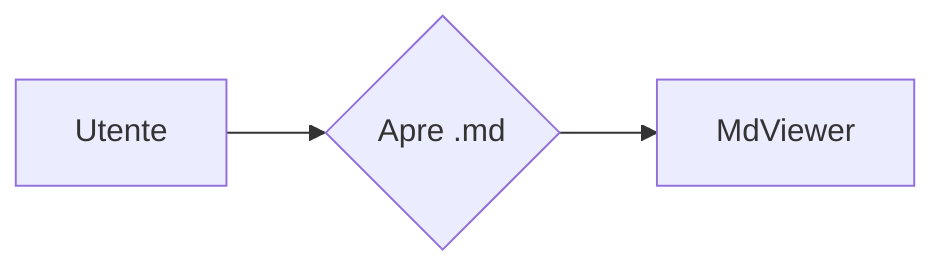

# Titolo principale

Testo con **grassetto**, *corsivo*, ~~barrato~~ e `codice [[non-wikilink]]`.

## Tabelle

| Colonna A | Colonna B | Allineata |
|-----------|-----------|----------:|
| uno       | due       | 3         |
| quattro   | cinque    | 6         |

## Task list

- [x] fatto
- [ ] da fare

## Wikilink

- Esistente: [[sub/altro]]
- Con alias: [[altro|Pagina altra]]
- Con ancora: [[sub/altro#Sezione due]]
- Mancante: [[non-esiste]]
- Link relativo: [altro](sub/altro.md)
- Link esterno: [Anthropic](https://www.anthropic.com)

```text
[[dentro-un-blocco]] non va convertito
```

## Mermaid



## PlantUML

```plantuml
Alice -> Bob: richiesta
Bob --> Alice: risposta
```

### Nota

> Citazione con nota[^1].

[^1]: Nota a piè di pagina.
